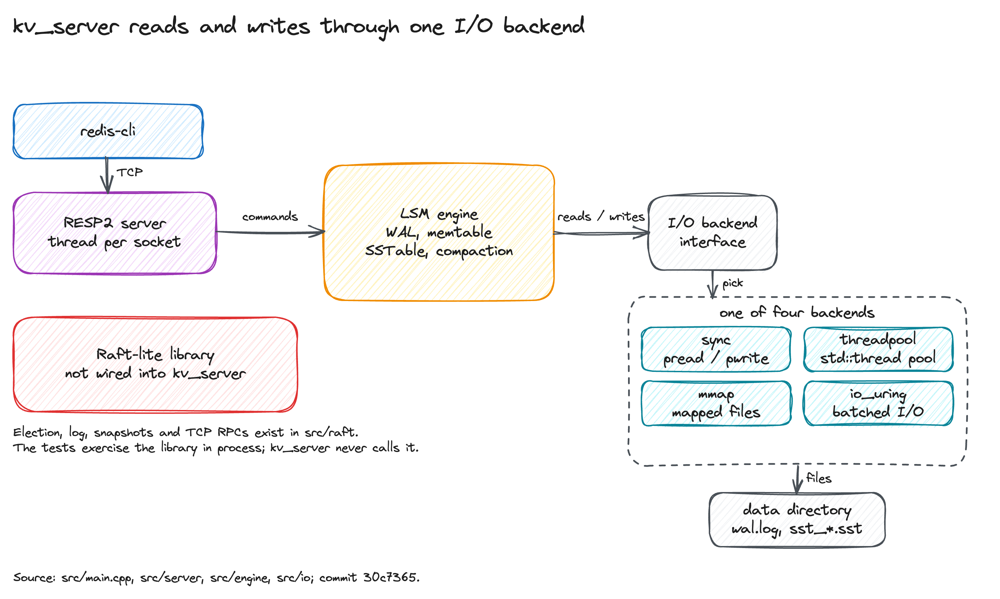

<h1 align="center" style="letter-spacing: 0.12em;">io_uring-key</h1>

<p align="center">A C++23 log-structured key-value store with a RESP2 server, four I/O backends, and a standalone Raft library.</p>

<br>

## What this is

`kv_server` is a single-process key-value server. It speaks RESP2 over TCP and
stores data in an LSM tree: a write-ahead log, a skip-list memtable, block-based
SSTables, and level-0 full compaction. Four backends implement one I/O
interface: `sync`, `threadpool`, `mmap`, and `io_uring`.

The repository also contains a Raft consensus library, a YCSB-inspired benchmark
harness, and a chart script. The server does not start the Raft library. The
source and runtime messages use the internal name `kernel-v2`.

This is a research prototype for systems programmers. It has known gaps. Read
[Limits](#limits) before you trust it with data.

## Requirements

The dev shell supplies liburing 2.14, GCC 16, Clang 22, CMake 4.1, Python 3,
matplotlib, and OpenSSL. Without Nix you need Linux with io_uring, liburing 2.14
or newer, CMake 3.28 or newer, and a C++23 compiler. The CI build uses GCC 13.
OpenSSL is needed only for `-DKV_ENABLE_TLS=ON`.

## Quick start

Linux only. The flake has dev shells for `x86_64-linux` and `aarch64-linux`;
there is no macOS dev shell.

```bash
nix develop
cmake -B build -DCMAKE_BUILD_TYPE=RelWithDebInfo
cmake --build build -j
ctest --test-dir build --output-on-failure
```

For TLS, configure with `-DKV_ENABLE_TLS=ON` and pass `--tls-cert` and
`--tls-key` when starting the server.

Start the server in one terminal:

```bash
./build/kv_server --port 6379 --backend sync --data-dir /tmp/kv_data
```

Use the Redis CLI that the dev shell provides:

```bash
redis-cli -p 6379 SET hello world
redis-cli -p 6379 GET hello
```

Run the benchmark and render its charts:

```bash
./build/kv_bench --keys 1000 --ops 5000 --output benchmark_results.csv
python3 tools/charts.py --input benchmark_results.csv --output charts/
```

Pass `--sync-wal` to `kv_bench` when you want each write fsynced. The default
skips the WAL fsync and records that policy in the CSV.

## Architecture



`kv_server` reads and writes through the LSM engine and one I/O backend. The
Raft code is a separate library in `src/raft`; the server never starts it. The
figure source and render command are in
[docs/figures/README.md](docs/figures/README.md).

## What works

- LSM engine: CRC-checked WAL with torn-tail repair, skip-list memtable,
  block SSTables with sparse indexes and bloom filters, level-0 full
  compaction, and temp-file renames with directory sync.
- I/O backends: `sync`, `threadpool`, `mmap`, and `io_uring`. The io_uring
  backend supports batched submission, registered buffers and files, and
  optional SQPOLL with a fallback. The engine still submits one operation at a
  time on its hot path.
- RESP2 server: `PING`, `ECHO`, `GET`, `SET`, `DEL`, `EXISTS`, `MGET`, `MSET`,
  `DBSIZE`, `FLUSHDB`, `INFO`, `SELECT`, `COMMAND`, `SCAN`, and `AUTH`.
- Transport: optional TLS with OpenSSL, enabled at build time with
  `-DKV_ENABLE_TLS=ON` and at runtime with `--tls-cert` and `--tls-key`.
- Server controls: optional shared-password auth, a connection limit, and an
  idle timeout. Set `--requirepass secret` or `KV_REQUIREPASS` to enable auth.
- Raft library: elections, log replication, a persistent log, snapshots, and a
  TCP transport. Unit and in-process cluster tests cover it.
- Benchmarks: YCSB-inspired A to F, including read-latest (D), 10-key scans
  (E), and read-modify-write (F). CSV export and matplotlib charts.

## Limits

- `SET ... EX` is rejected with an error. TTL is not implemented.
- `MSET` is one batch WAL record. A torn batch is discarded as a unit, so it
  does not leave a prefix. A crash after a full batch is recovered as a batch.
- The Raft library is not part of the server. The leader serves reads without a
  ReadIndex confirmation.
- TLS is optional. Without `--tls-cert` and `--tls-key`, `AUTH` is a shared
  password over plain TCP, so do not expose that mode to an untrusted network.
- `SCAN` and benchmark workload E collect every live key for each call. They are
  correct at small scale and do not scale with the dataset.
- The benchmark uses uniform keys, not the Zipfian distribution of the default
  YCSB driver.
- Crash tests use SIGKILL. Directory fsync is covered by a fault-injection test,
  not by a real power cut.
- Compaction is a full level-0 merge. There is no leveled compaction.

## Benchmarks

`./build/kv_bench --keys 1000 --ops 5000` on a Linux 7.2 aarch64 VM with four
vCPUs. All rows use `sync_wal=false`.

| Backend | A | B | C | D | E | F |
| --- | ---: | ---: | ---: | ---: | ---: | ---: |
| `sync` | 1.00M | 3.13M | 5.65M | 3.84M | 14.3k | 911.5k |
| `threadpool` | 63.8k | 530.7k | 5.41M | 600.9k | 13.6k | 68.4k |
| `mmap` | 45.7k | 395.1k | 5.49M | 428.5k | 13.5k | 44.6k |
| `io_uring` | 90.8k | 732.2k | 5.47M | 693.3k | 13.5k | 81.7k |

A is 50/50 read/write, B is 95/5, C is read-only, D reads the latest key, E
spends 95% of operations on 10-key scans, and F spends 50% on read-modify-write.
The scan numbers are low because each scan rebuilds the live-key set. Treat the
table as a smoke benchmark, not a production comparison.

## Layout

| Path | Contents |
| --- | --- |
| `src/engine` | LSM engine: get, put, delete, flush, compaction, recovery |
| `src/wal`, `src/memtable`, `src/sstable`, `src/compaction` | Storage pieces |
| `src/io` | `IOBackend` interface and four backends |
| `src/server` | RESP2 parser, command handler, TCP server |
| `src/raft` | Standalone Raft library and TCP transport |
| `src/bench`, `tools` | Benchmark harness and chart script |
| `tests` | doctest suite |
| `docs` | Audit and figure sources |

## Tests

`ctest --test-dir build` runs 77 doctest cases in the default build, 78 with
TLS, and 85 with the io_uring backend. The suite covers WAL tail repair, batch
WAL recovery, randomized engine operations against `std::map`, SIGKILL
recovery, simulated power loss, directory fsync ordering, RESP parsing,
malformed socket input, compaction, concurrent readers, Raft persistence and
snapshots, a three-node TCP cluster, and a TLS handshake.

CI runs the default 77-case build, AddressSanitizer with UndefinedBehaviorSanitizer,
ThreadSanitizer, and a TLS build. Run the 85-case io_uring suite on a Linux host.

The crash tests use SIGKILL, and the power-loss test uses a fault-injecting
backend that drops unsynced directory entries. Neither is a real hardware power
cut. The Raft tests use sleeps and are timing-sensitive.

## Docs

- [DESIGN.md](DESIGN.md): design notes and the backend contract.
- [docs/AUDIT.md](docs/AUDIT.md): the original findings and their remediation.
- [docs/figures/README.md](docs/figures/README.md): figure source and render
  command.
